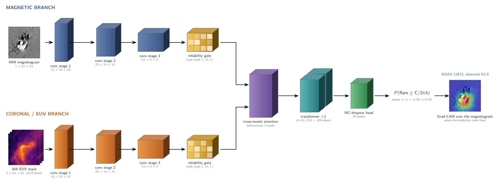

# Reliability-Gated Fusion for Solar Flare Prediction

A research prototype that predicts whether a solar active region will produce a C-class
flare or larger within the next 24 hours, from an HMI line-of-sight magnetogram and eight
AIA extreme-ultraviolet (EUV) passbands. The repository includes a trained model and a
Streamlit app for running it interactively.



## The problem

Flare forecasting from solar imagery is usually done from the magnetogram alone, because the
photospheric magnetic field holds the free energy that drives an eruption. The corona carries
a second, partly independent signal: pre-flare brightening and loop restructuring often show
up in the AIA EUV passbands before the X-ray flux rises, so combining the two inputs should
help.

The catch is that the obvious way to combine them, stacking both into one encoder, is
fragile. In a clean benchmark both inputs are always present, but a real instrument drops
out during eclipse, saturates on bright flares, and drifts in sensitivity over its lifetime.
A model that has learned to lean on the EUV channel has no way to tell when that channel is
worthless, and a single degraded frame can overwhelm a perfectly good magnetogram.

## The solution

Instead of trusting every input equally, a **reliability gate** learns a per-pixel trust
mask for each modality from its own feature map and scales that modality by the mask before
fusion. The idea is borrowed from multimodal medical imaging, where modalities such as PET
and CT disagree in predictable ways. Because the mask varies spatially, the network can
distrust one input in part of the field of view and keep it elsewhere.

The gate is trained with **corruption-aware augmentation**: on half of the training samples,
one of the two modalities is mixed toward uniform noise by a random amount, so the gate is
exposed to degraded inputs during training rather than only at test time.

## Architecture

Each sample is a magnetogram patch (1x64x64) and an EUV stack (8x64x64), passed through five
stages:

1. **Separate encoders.** Each modality has its own three-stage convolutional encoder
   (16 to 32 to 64 channels, resolution halved at each stage) down to a 64x8x8 feature map.
   No weights are shared between the two.
2. **Reliability gate.** Two 1x1 convolutions and a sigmoid produce a single-channel trust
   mask in (0,1), and the features are scaled by it.
3. **Cross-modal attention.** Both gated maps become 64 tokens of dimension 64. Two
   attention blocks run in opposite directions so each modality can reinforce or discount the
   other at the same spatial location.
4. **Transformer aggregation.** A learned CLS token is prepended and the sequence passes
   through two transformer encoder layers, collecting evidence from the whole active region.
5. **MC-dropout head.** Dropout stays active at inference, so 30 stochastic passes give a
   flare probability together with an uncertainty estimate.

The full network has 247,955 parameters, small enough to train the whole ablation on a
single mid-range GPU.

## Results

On the full SDOBenchmark split (8,336 training, 886 test samples), scored once per run over
five seeds:

| Model | TSS | AUC |
|---|---|---|
| Magnetogram only | 0.602 ± 0.019 | 0.876 ± 0.006 |
| EUV only | 0.560 ± 0.101 | 0.865 ± 0.058 |
| Concatenation | 0.510 ± 0.215 | 0.873 ± 0.029 |
| **Reliability-gated** | **0.643 ± 0.010** | **0.902 ± 0.002** |

Two findings held up. The gate beats the best single-input baseline by 0.041 ± 0.013 TSS and
wins on all five seeds, and it prevents the training collapse that sank plain concatenation
on one seed in five (TSS 0.080). One did not: the gate does **not** make the model more
robust to a corrupted EUV frame. That robustness comes from corruption-aware training, which
helps the concatenation baseline just as much. The trust masks show why, the EUV mask stays
near 1 almost everywhere, so it suppresses very little.

## Run the app

```bash
pip install -r requirements.txt
streamlit run app.py
```

Opens at http://localhost:8501. The trained checkpoint `rgfusion_checkpoint.pt` ships with
the repository and holds all four variants (`mag`, `euv`, `concat`, `full`).

The app lets you:

- Predict on real SDOBenchmark active regions bundled in `samples/`, each with ground truth,
  or upload your own magnetogram and EUV images.
- Switch between the four trained variants on the same input.
- Drag an **instrument-failure slider** that degrades the EUV stack toward noise, to see how
  each variant reacts to a simulated data gap or saturated detector.
- Inspect **Grad-CAM** over both encoders and, for the gated model, the learned per-pixel
  trust masks.
- See the **MC-dropout uncertainty** as a histogram rather than a single number.

## Repository layout

```
app.py          Streamlit interface
model.py        Reliability-gated fusion network, Grad-CAM, MC-dropout
data.py         SDOBenchmark loading and splitting
train.py        Training and five-seed evaluation
metrics.py      TSS, HSS, threshold selection
samples/        Bundled active regions, one folder each
rgfusion_checkpoint.pt   Trained weights for all four variants
```

To reproduce the numbers above:

```bash
python train.py --variant full --seeds 5
```

## Caveat

This is a research prototype, not an operational forecaster. The model works on 64x64
downscaled single-timestep patches at the C-class threshold, and uniform noise is only a
rough stand-in for real instrument failures such as eclipses and saturation.
